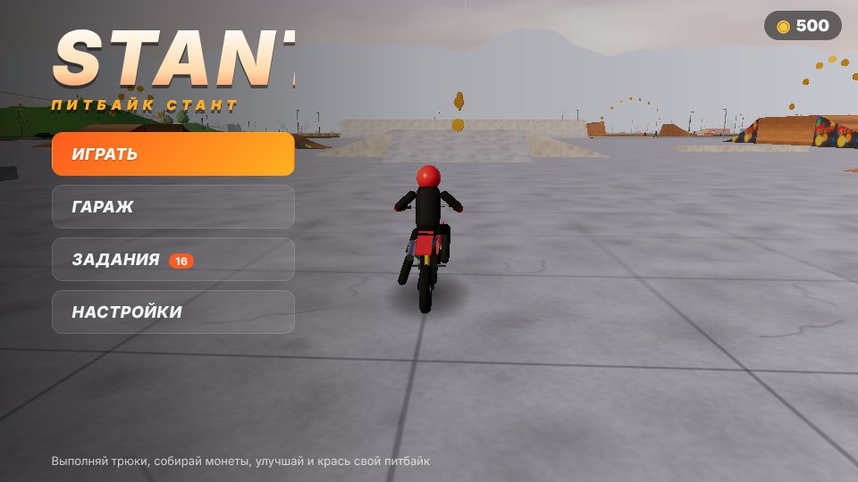
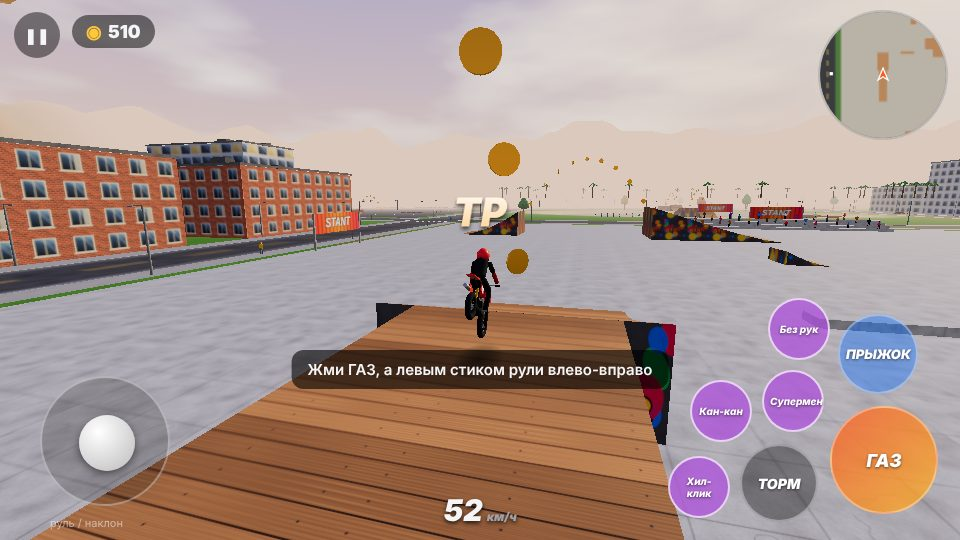
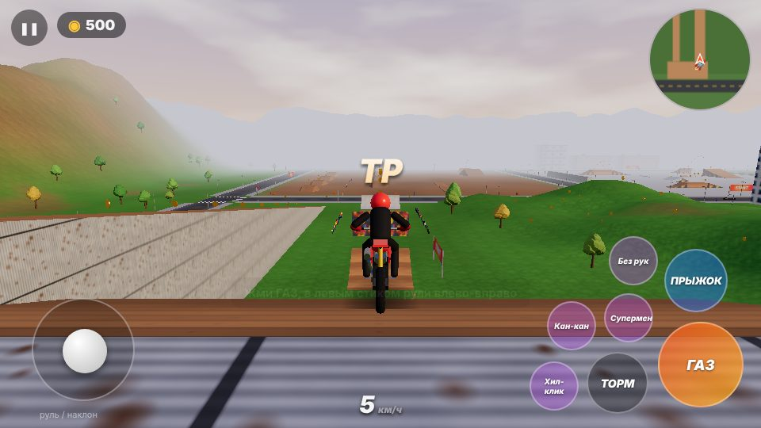
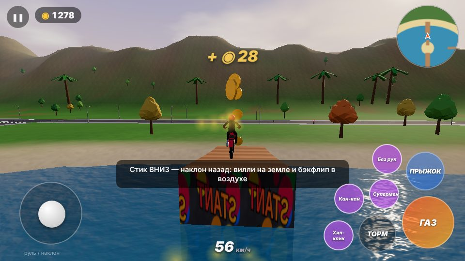
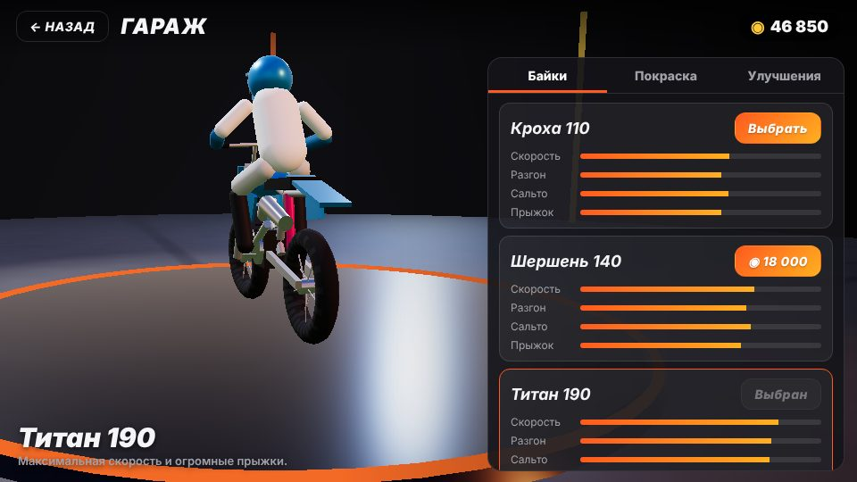
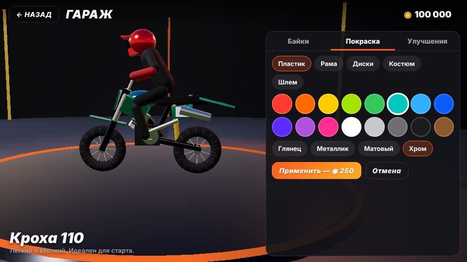

# STANT — питбайк стант (Android)

3D-игра про стант на питбайках в открытом мире. Горизонтальная ориентация, Android.

## Скачать
Готовый APK: [`apk/stant-latest.apk`](apk/stant-latest.apk) (также версии `apk/stant-<версия>-<дата>.apk`).
APK собирается автоматически в GitHub Actions при каждом изменении кода и коммитится в папку `apk/`.

## Что есть в игре
- **Открытая карта ~900×900 м**: стант-парк, мега-рампа (24 м), мотокросс-трасса, стройка с контейнерами,
  озеро с прыжками через воду на остров, парковка с прыжками через машины, деловой центр, площадь со ступенями, маршрут по крышам, холмы и горы.
- **Камера**: поворот пальцем, 5 видов (сзади, сбоку, низко, издалека, кино).
- **Механика станта**: вилли и стоппи (с балансом, позы на заднем колесе — очки ×2.2), подскок с подгрузкой подвески, бэкфлип/фронтфлип,
  вращения 360°, позы (Супермен, Кан-кан, Без рук, Хил-клик), вертикальные вылеты с квотерпайпов,
  замедление времени на красивых трюках, кинематографичная камера, идеальные посадки, эффектные падения.
- **Валюта**: очки за трюки складываются в комбо (множитель = число трюков) и превращаются в монеты.
  Плюс монеты на карте и награды за 16 заданий.
- **Гараж**: 3 питбайка, покраска 5 частей (16 цветов, 4 типа покрытия — глянец, металлик, мат, хром),
  4 улучшения по 5 уровней (двигатель, подвеска, шины, баланс).
- **Жизнь в городе**: машины ездят по дорогам (тормозят перед игроком, сигналят), пешеходы гуляют и уворачиваются,
  зрители у мест для трюков болеют за игрока.
- **Графика**: все текстуры процедурные (асфальт с разметкой, трава, земля, песок, бетон, доски, граффити, фасады),
  небо с облаками, тени, отражения окружения, туман, частицы пыли/брызг/искр, следы шин.
- **Оптимизации**: статичная геометрия объединена по материалам, инстансинг деревьев/машин/людей/монет,
  динамическое разрешение по FPS, три уровня графики (авто-выбор), тени только вокруг игрока, пул частиц без аллокаций,
  сетка для быстрых запросов физики, редкая перерисовка на паузе, анимация далёких людей реже.

## Структура
- `game/` — код игры (JavaScript + Three.js), сборка `npm run build` (esbuild).
- `android/` — Android-обёртка (WebView), Gradle-проект.
- `apk/` — собранные APK.
- `docs/` — документация, `docs/ideas/` — идеи и планы.
- `.claude/skills/` — скиллы Claude для проекта.
- `.github/workflows/android.yml` — сборка APK.

Подробнее: [docs/architecture.md](docs/architecture.md), управление — [docs/controls.md](docs/controls.md).

## Скриншоты
| | |
|---|---|
|  |  |
|  |  |
|  |  |
